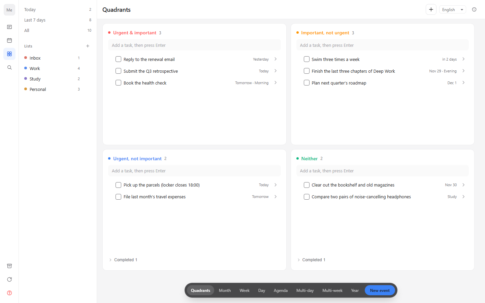
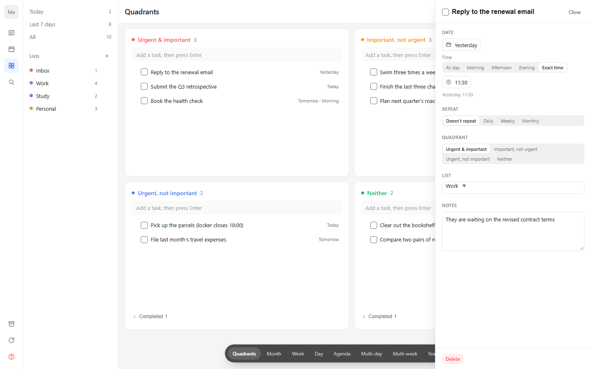
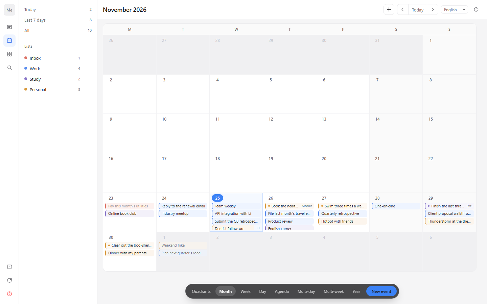
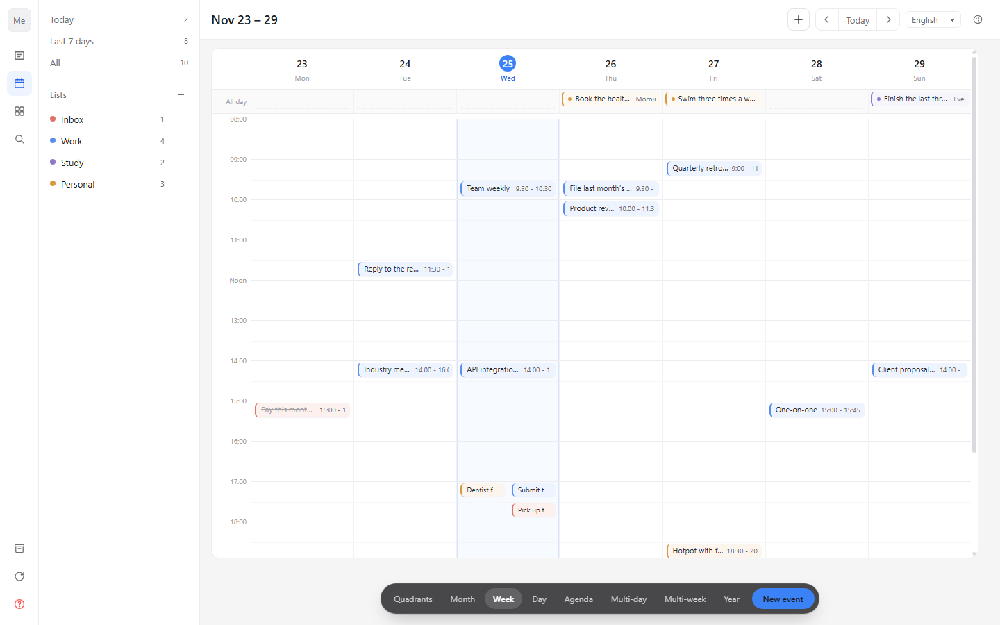
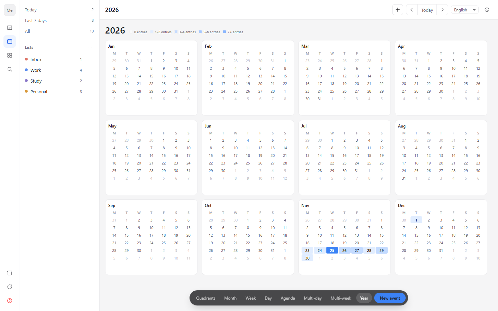
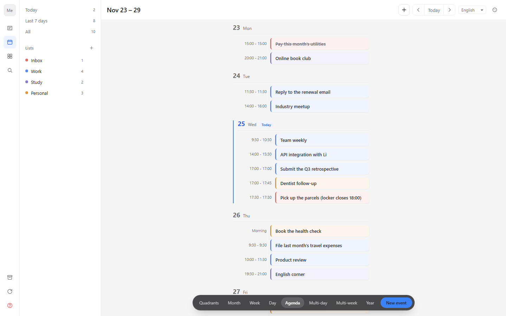

# Kairos

**A to-do list and calendar that belongs to you alone.**

No sign-up. No sync. No telemetry. Every task and event lives in a single SQLite file on your own machine. Cut your network connection and it keeps working.

> **Kairos** (Greek καιρός) — the opportune moment, as opposed to *chronos*, the mere passage of time.
> The name is a standpoint: **not every task needs a time of day.**

[](https://github.com/VitaVance/Kairos/releases/latest)
[](LICENSE)
[](#download)

English · [简体中文](README.zh-CN.md)

---

## Why it exists

Most task managers assume you live inside someone else's schedule: shared calendars, cross-device reminders, an account you have to keep alive. If all you want is to know what to do today, those are overhead.

Kairos is built on a narrower bet:

| | Most to-do apps | Kairos |
| --- | --- | --- |
| Where your data lives | My servers | **Your computer** |
| Do you need an account | Yes | **No** |
| Works offline | No | **Entirely** |
| Must a task have a time | Yes | **No — "today" is enough** |
| What free costs you | Ads, analytics, upsells | **Nothing. MIT, source included.** |

---

## Features



### Quadrants: decide *whether* before *when*

A task carries only two facts — **important** and **urgent**. The four quadrants are derived from those, so you never file anything into a box by hand:

```
┌─────────────────────┬─────────────────────┐
│  Important · Urgent │ Important · Not now │
│  Do it now          │ Schedule it         │
├─────────────────────┼─────────────────────┤
│ Urgent · Unimportant│ Neither             │
│ Delegate or do fast │ Let it go           │
└─────────────────────┴─────────────────────┘
```

Drag a card to another quadrant and its two flags follow — no detail panel, no two-step menu.

### Not every task needs a time of day

This is where Kairos differs most from other task apps.

When you write something down, you say how precisely it is scheduled — or that it isn't:

- **Today** — get it done, the hour doesn't matter
- **Morning / afternoon / evening** — roughly when, no deadline
- **14:30** — a real moment: a meeting, an interview, a flight

The first three sit quietly in the calendar's all-day strip. They never carve a fake time block out of your grid. Only tasks you gave an exact moment occupy a slot.

> A calendar that refuses to admit most tasks have no clock time is a calendar that makes you invent times you do not mean.



### Six ways to look at one body of data

| Month | Week |
| --- | --- |
|  |  |
| **Year — density at a glance** | **Agenda** |
|  |  |

| View | When you reach for it |
| --- | --- |
| **Year** | See which months were crowded at a glance; click any month to enter it |
| **Month** | Routine planning. Click a date for the day; double-click empty space to create an event |
| **Multi-week** | The rhythm of the next two or three weeks; click a week number to zoom in |
| **Week** | The full week on a time axis; drag across the grid to select a time block |
| **Multi-day** | 3 / 5 / 7 days side by side, for work that spans days |
| **Day** | Single-day focus, with 15-minute precision when you drag |

All six connect: year → month → day, multi-week → week → day, in both directions. You never get stuck at one zoom level.

### Reminders that actually arrive

When an event is about to start you get a **Windows system notification**, not a badge inside the app. Close the window and it doesn't matter — the app lives in the system tray and keeps its clock running.

### The rest

- **Quick capture** — `buy groceries tomorrow`, `report @14:00`
- **Recurring tasks** — daily / weekly (pick the weekdays) / monthly; completing ticks it and creates the next one
- **Undo** — deleted or changed by mistake? `Ctrl+Z` brings it back
- **Search** — `Ctrl+K` across every task and event
- **Three palettes × light/dark** — switchable from the top-right corner
- **Import / export** — full JSON backup round-trips; CSV for taking data elsewhere

---

## Download

**[⬇ Latest release](https://github.com/VitaVance/Kairos/releases/latest)**

| File | Notes |
| --- | --- |
| `Kairos_x.y.z_x64-setup.exe` | **Recommended.** Small installer, supports automatic updates |
| `Kairos_x.y.z_x64_zh-CN.msi` | MSI package, suited to bulk deployment |

Install and launch from the Start menu.

> **First run shows "Windows protected your PC."**
> The installers are not code-signed yet — a certificate costs a few hundred dollars a year, and the application is pending the free SignPath Foundation programme for open-source projects. Click **More info → Run anyway**. All source code is in this repository, so you can audit it or build it yourself.

**Requirements:** Windows 10 1809+ / Windows 11. The installer fetches the WebView2 runtime automatically if it is missing.

---

## Where your data lives

```
C:\Users\<you>\AppData\Roaming\app.todolist.local\todolist.db
```

One SQLite file. **Copy it and you have a complete backup; delete it and you have wiped everything.** Moving to a new machine means putting that file in the same place — no login of any kind.

There is also a JSON export in the app's data panel: a versioned, round-trippable format.

Kairos contains no account system, no cloud sync, no telemetry, no crash reporting, no usage statistics, no advertising SDK and no third-party analytics. It makes no business network requests at all; the only outbound connection is the update check, which you can turn off.

---

## In practice

**Two minutes in the morning to lay out the day**

No times, just things: "write the quarterly summary", "reply to Li's email", "pick up the parcel". Some get "morning", most get nothing. Finished ones get ticked; the rest carry over tomorrow.

**Meetings and tasks kept apart**

A meeting has a real hour and blocks that stretch on the time grid. A task is just "do this today" and floats in the all-day strip without pretending to occupy two hours.

**Friday afternoon, scanning next week**

Switch to multi-week and see three things stacked on Wednesday — move one to Tuesday. One drag.

**Half a year later**

The year view shows each month's density at a glance. Which months were swallowed by meetings, which had room for real work.

---

## Building from source

See [CONTRIBUTING.md](CONTRIBUTING.md). The short version:

```bash
corepack enable && pnpm install
pnpm tauri build          # produces .exe / .msi
```

Requires Node.js ≥ 22, pnpm 11, Rust ≥ 1.77 and the MSVC toolchain. To look at the interface in a browser only, `pnpm dev` needs none of that.

---

## Documentation

**Using it**

- [docs/PACKAGING.md](docs/PACKAGING.md) — packaging, signing, release process

**Working on it**

- [docs/ARCHITECTURE.md](docs/ARCHITECTURE.md) — the four layers, dependency direction, how to extend
- [docs/THEMING.md](docs/THEMING.md) — design tokens and adding a palette
- [docs/RELEASING.md](docs/RELEASING.md) — how a release is cut
- [CONTRIBUTING.md](CONTRIBUTING.md) — workflow and the gates a change must pass
- [SECURITY.md](SECURITY.md) — security model and how to report a vulnerability
- [ADR 0001](docs/adr/0001-targets-and-shell.md) / [0002](docs/adr/0002-layered-architecture.md) / [0003](docs/adr/0003-local-first-persistence.md) — decision records

---

## License

[MIT](LICENSE) © 2026 Kairos contributors

Use it, change it, redistribute it. If you make it better, a pull request is welcome.
