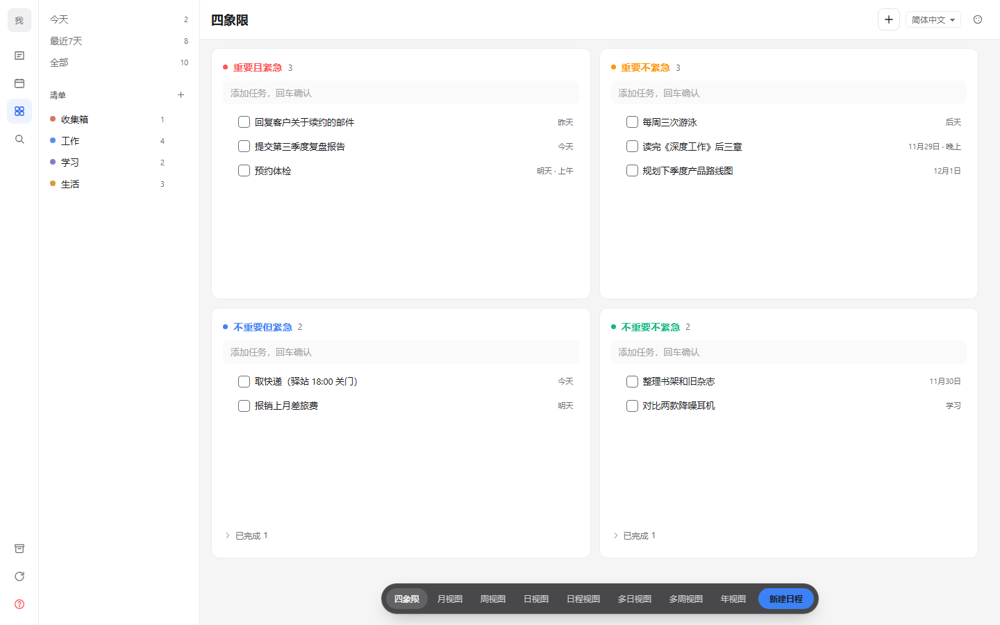
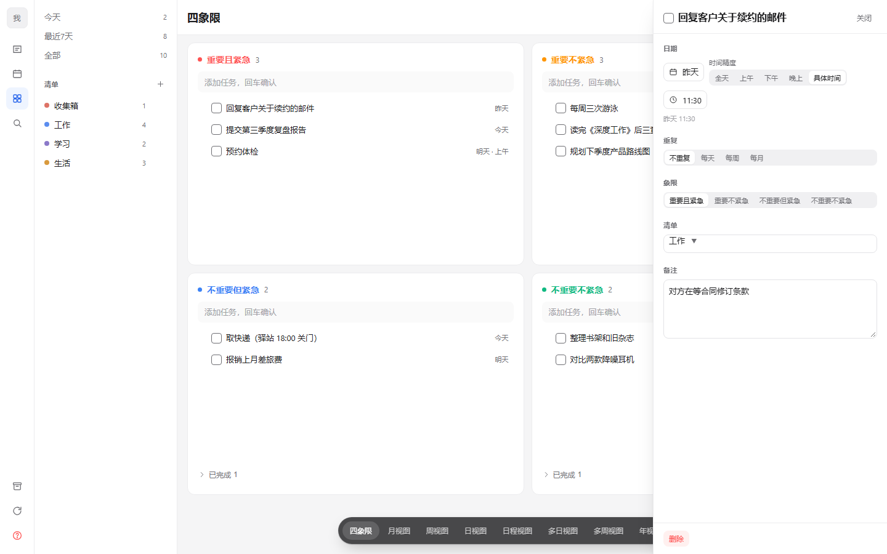
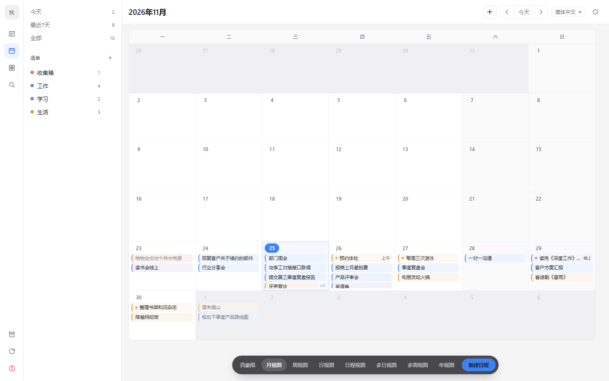
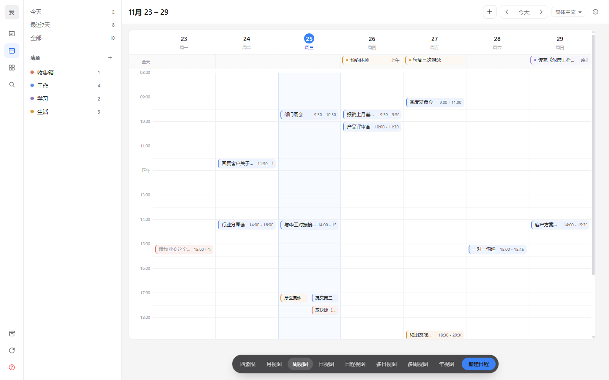
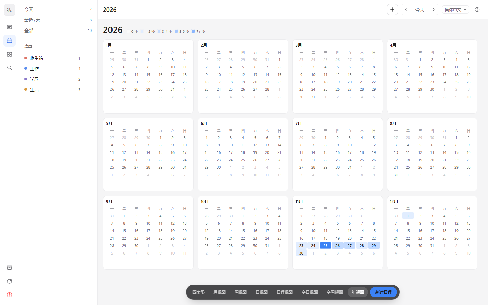
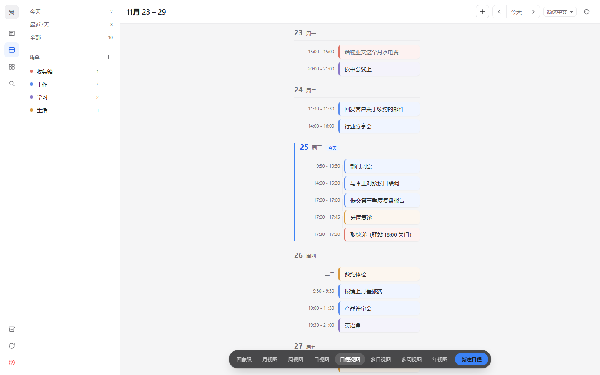

# Kairos

**一个只属于你自己的待办清单与日历。**

不注册、不登录、不联网、不同步。你写的每一条任务、每一个日程，都只保存在你自己电脑上的一个 SQLite 文件里。关掉网络，它照常工作。

> **Kairos**（希腊语 καιρός）——「关键时刻」。与按钟表计算的 *chronos* 相对。
> 这个名字是态度：**不是每一件事都需要定到几点几分。**

[](https://github.com/VitaVance/Kairos/releases/latest)
[](LICENSE)
[](#下载)

[English](README.md) · 简体中文

---

## 为什么是它

大多数待办应用假设你活在别人的日程表里：共享、协作、跨设备提醒、订阅日历。可如果你只是想知道「今天该干什么」，这些大多是负担。

Kairos 的取舍很明确：

| | 大多数待办应用 | Kairos |
| --- | --- | --- |
| 数据在哪 | 我的服务器 | **只在你的电脑上** |
| 需要账号吗 | 需要 | **不需要** |
| 断网能用吗 | 不能 | **完全能** |
| 任务必须定时间吗 | 是的 | **不用，说「今天」就够了** |
| 免费的代价 | 广告 / 样本数据 / 付费墙 | **没有代价，MIT 开源** |

---

## 功能



### 四象限：先想清楚要不要做，再想什么时候做

任务只有两个属性——**重要**、**紧急**。四象限自动生成，不需要你手动归到某个格子里：

```
┌─────────────────────┬─────────────────────┐
│  重要 · 紧急        │  重要 · 不紧急      │
│  立刻处理           │  安排时间           │
├─────────────────────┼─────────────────────┤
│  紧急 · 不重要      │  不重要 · 不紧急    │
│  委托或速办         │  可以不做           │
└─────────────────────┴─────────────────────┘
```

拖动任何一张任务卡片到另一个象限，它的属性就跟着改了——不用打开详情、不用点两次菜单。

### 任务不需要具体到几点

这是 Kairos 与别的待办应用最不一样的地方。

写一件事的时候，你可以只说它属于**哪一天**，或者属于**哪半天**：

- 「**今天**」——做完就行，不关心几点
- 「**今天上午**」／「**下午**」／「**晚上**」——有个大致时段，但没有死线
- 「**14:30**」——真有明确的时刻，比如会议、面试、航班

前三种会安静地躺在日历顶部的「全天」区域里，不会在你的时间网格上切出一块假的时间块。只有你明确指定了时刻的事件，才会占据具体的时段。

> 一个不肯承认「大多数任务没有确切时间」的日历，只会逼你编造时间。



### 六个视角看同一份数据

| 月视图 | 周视图 |
| --- | --- |
|  |  |
| **年视图 —— 密度一目了然** | **日程视图** |
|  |  |

| 视图 | 什么时候用 |
| --- | --- |
| **年** | 一眼看到全年哪天最忙，点任意月份直接进去 |
| **月** | 常规规划。点日期进日视图，双击空白处直接建日程 |
| **多周** | 看未来两三周的节奏；点周号进周视图 |
| **周** | 一周的完整时间轴，可以按住拖拽选出时间块 |
| **多日** | 3 / 5 / 7 天并排，适合排跨天的活 |
| **日** | 单天聚焦，拖拽建日程精确到 15 分钟 |

六个视图互相可跳转：年 → 月 → 日，多周 → 周 → 日，全部双向可达。不会把你困在某一个层级里。

### 提醒是真的会响

日程快开始时，会弹 **Windows 系统通知**，不是应用内的小红点。关掉窗口也没关系——应用会缩到系统托盘继续计时，到点照常提醒。

### 其余

- **快速捕获**——`明天 买菜`、`周报 @14:00` 这类简写直接解析
- **重复任务**——每天 / 每周（可指定周几）/ 每月，完成后自动推进到下一次
- **撤销**——误删、误改，`Ctrl+Z` 都能回来
- **搜索**——`Ctrl+K` 全库检索任务和日程
- **三套皮肤 × 浅色/深色**——右上角随时切
- **导入导出**——JSON 全量备份可往返；CSV 供导出到别的工具

---

## 下载

**[⬇ 最新版本](https://github.com/VitaVance/Kairos/releases/latest)**

| 文件 | 说明 |
| --- | --- |
| `Kairos_x.y.z_x64-setup.exe` | **推荐**，安装器较小，支持自动更新 |
| `Kairos_x.y.z_x64_zh-CN.msi` | MSI 安装包，适合企业批量部署 |

安装后从开始菜单打开即可。

> **首次运行会看到「Windows 已保护你的电脑」**
> 这是因为安装包还没有代码签名证书（一张证书每年数百美元），项目正在申请 SignPath Foundation 的免费开源签名。点「**更多信息**」→「**仍要运行**」即可。程序的全部源代码都在这个仓库里，你可以自己审计或自己构建。

**系统要求：** Windows 10 1809+ / Windows 11。Windows 10 若缺少 WebView2 运行时，安装器会自动补装。

---

## 你的数据在哪

```
C:\Users\<你的用户名>\AppData\Roaming\app.todolist.local\todolist.db
```

一个 SQLite 文件。**复制它就是完整备份，删掉它就是彻底清空。**

换电脑时，把文件拷到新机器的同一位置即可——不需要登录任何东西。

也可以通过应用内的「数据」面板导出 JSON 备份，那是带版本号、可校验的往返格式。

Kairos **不包含**：账号系统、云同步、遥测、崩溃上报、使用统计、广告 SDK、第三方分析。它不发起任何业务网络请求，唯一的对外连接是检查更新（可关闭）。

---

## 使用场景

**早上花两分钟列今天的清单**

不看时间，只列事情：「写季度总结」「回李工的邮件」「取快递」。有的加个「上午」，有的什么都不加。做完打勾，没做完明天继续。

**把会议和任务分开放**

会议有确切时间，落进时间网格里堵住那一段。任务只是「今天要做」，浮在全天区不会假装自己占了两小时。

**周五下午看下周**

切到多周视图扫一眼，看到下周三堆了三件事——提前把其中一件挪到周二。拖一下就完事。

**半年后回头看**

年视图里每个月的密度一眼可见。哪几个月被会议淹没，哪几个月有空做正经事。

---

## 从源码构建

见 [CONTRIBUTING.md](CONTRIBUTING.md)。简版：

```bash
corepack enable && pnpm install
pnpm tauri build          # 产出 .exe / .msi
```

需要 Node.js ≥ 22、pnpm 11、Rust ≥ 1.77、MSVC 工具链。只想在浏览器里看界面的话 `pnpm dev` 即可，不需要 Rust。

---

## 文档

**用户相关**

- [docs/PACKAGING.md](docs/PACKAGING.md) — 打包、签名、发布流程

**开发者相关**

- [docs/ARCHITECTURE.md](docs/ARCHITECTURE.md) — 四层结构、依赖方向、扩展方式
- [docs/THEMING.md](docs/THEMING.md) — 设计令牌与新增皮肤
- [docs/RELEASING.md](docs/RELEASING.md) — 发布流程
- [CONTRIBUTING.md](CONTRIBUTING.md) — 开发流程与必须通过的门槛
- [SECURITY.md](SECURITY.md) — 安全模型与漏洞报告
- [ADR 0001](docs/adr/0001-targets-and-shell.md) / [0002](docs/adr/0002-layered-architecture.md) / [0003](docs/adr/0003-local-first-persistence.md) — 关键决策记录

---

## 许可证

[MIT](LICENSE) © 2026 Kairos contributors

随意使用、修改、分发。如果你把它改成自己喜欢的样子，欢迎提 PR 回来。
