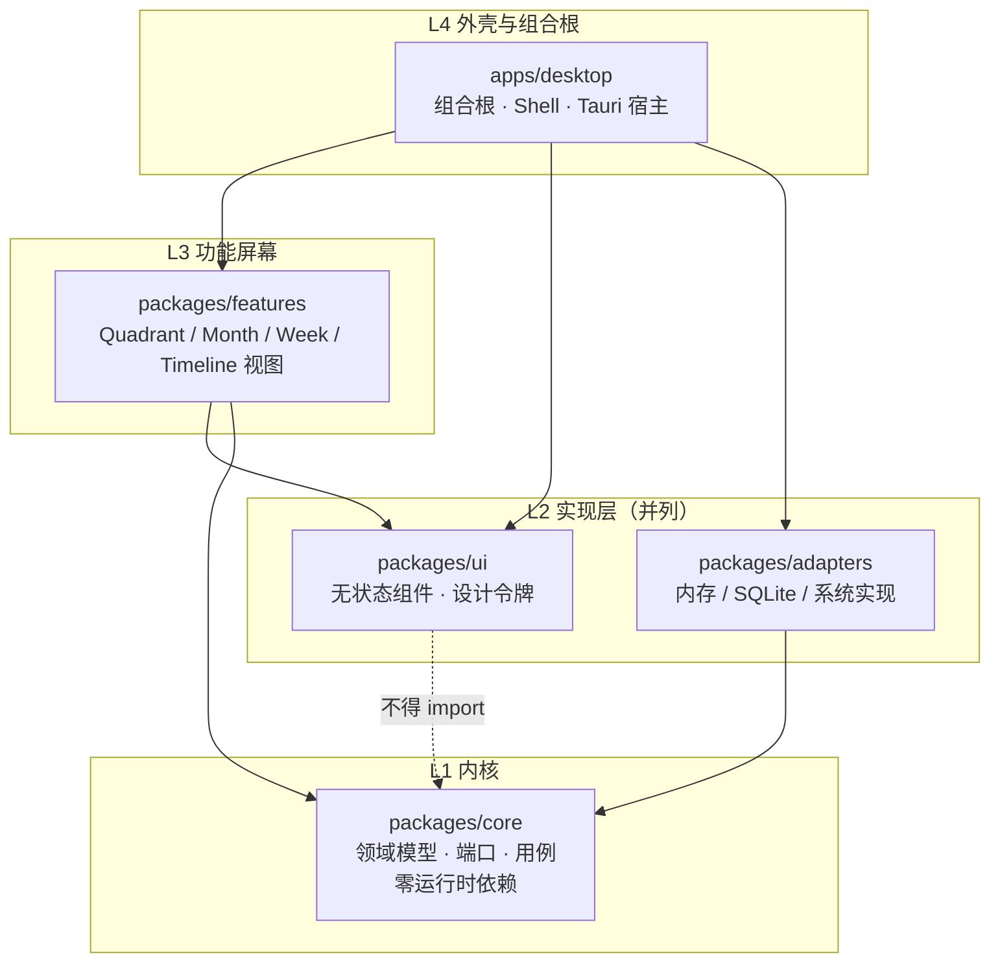

# 架构说明

本文描述仓库的四层结构、依赖方向、端口契约，以及最常见的三类扩展怎么做。所有路径都相对仓库根目录。

> 这份文档面向要改代码的人。只想用这个应用的读者请回到 [README](../README.md)。

## 0. 仓库结构

```text
todolist/
├─ apps/
│  └─ desktop/                       # 桌面应用：组合根 + 外壳 + Tauri 2 宿主
│     ├─ src/
│     │  ├─ App.tsx                  # 组合根：选存储后端、注入时钟与 ID 生成器
│     │  ├─ composition.ts           # createServices()：装配 TaskService / CalendarService
│     │  ├─ main.tsx                 # React 入口，加载 ui/features 样式
│     │  ├─ app.css                  # 外壳布局，只消费 --tl-* 设计令牌
│     │  └─ shell/                   # Shell / SideRail / TopBar / icons
│     ├─ src-tauri/                  # Rust 壳：lib.rs 注册插件与托盘，tauri.conf.json
│     ├─ index.html
│     ├─ vite.config.ts              # 固定 5173 端口
│     └─ tsconfig.json
├─ packages/
│  ├─ core/                          # 内核：领域 + 端口 + 用例，零运行时依赖
│  │  ├─ src/
│  │  │  ├─ domain/                  # types.ts、task.ts、calendar.ts、recurrence.ts
│  │  │  ├─ ports/                   # repository.ts（仓储 + UnitOfWork + Clock + IdGenerator）
│  │  │  ├─ application/             # task-service.ts、calendar-service.ts、list-service.ts
│  │  │  ├─ shared/                  # date.ts（本地日期与 ISO 时刻）、temporal-runtime.ts
│  │  │  └─ index.ts                 # 包的公开 API
│  │  └─ test/core.test.ts           # 纯内核测试，自带内存适配器作为端口契约基线
│  ├─ adapters/                      # 端口实现：内存与 SQLite 两套 UnitOfWork
│  │  └─ src/
│  │     ├─ memory/                  # MemoryUnitOfWork（浏览器开发用）
│  │     ├─ sqlite/                  # SqliteUnitOfWork、schema.ts（迁移）、mapping.ts
│  │     └─ system/                  # SystemClock、CryptoIdGenerator、seedDemoData
│  ├─ ui/                            # 无状态展示组件 + 设计令牌
│  │  └─ src/                        # tokens.css、styles.css、components/
│  └─ features/                      # 屏幕与视图
│     └─ src/                        # calendar/、quadrant/、task/、pickers/、reminders/、undo/
├─ design/
│  ├─ index.html                     # 三个候选方向的对比画廊
│  └─ A-refined.html / B-pro-tool.html / C-warm-editorial.html
├─ scripts/
│  ├─ verify.sh                      # 本地一键验证（与 CI 同步骤）
│  └─ check-toolchain.mjs            # 构建前置检查
├─ .github/workflows/                # ci.yml + release.yml
├─ .dependency-cruiser.cjs           # 分层边界的机器可执行规则
├─ docs/
│  ├─ ARCHITECTURE.md                # 本文
│  ├─ THEMING.md                     # 设计令牌与新增皮肤
│  ├─ PACKAGING.md                   # 打包、签名、发布
│  └─ adr/                           # 架构决策记录
│     ├─ 0001-targets-and-shell.md
│     ├─ 0002-layered-architecture.md
│     └─ 0003-local-first-persistence.md
├─ package.json
├─ pnpm-workspace.yaml
└─ tsconfig.base.json                # TypeScript strict 基线配置
```

## 1. 依赖方向

洋葱 / 六边形结构：依赖**只允许向内**。`core` 不知道外界的任何具体实现；外壳（`apps/desktop`）是唯一装配具体适配器的地方。



三条硬规则，由 `pnpm deps:check` 机械强制：

1. `packages/core` 不依赖任何东西。
2. `packages/ui` 仅展示，**不得 import `@todolist/core`**。
3. `packages/features` 不得 import adapters 或 `apps/*`。

## 2. 端口契约

`packages/core/src/ports/repository.ts` 定义三个端口，实现层必须满足：

| 端口 | 职责 | 实现 |
| --- | --- | --- |
| `UnitOfWork` | 任务 / 清单 / 事件三套仓储的原子访问 | `MemoryUnitOfWork`、`SqliteUnitOfWork` |
| `Clock` | 唯一的时间来源，便于测试 | `SystemClock`、测试用的固定时钟 |
| `IdGenerator` | 唯一 ID 来源 | `CryptoIdGenerator`、测试用的递增生成器 |

**两套 `UnitOfWork` 必须通过同一套契约测试。** 这是 ADR 0003 的要求：内存实现是浏览器开发的便利，SQLite 是发布形态，两者行为不能有分歧。

## 3. 数据模型的两个派生原则

### 四象限是派生的，不是存储的

任务只存 `important` / `urgent` 两个布尔值，象限由 `quadrantOf()` 计算。数据库里**没有** quadrant 列——加入它就会得到两个可能不一致的真相。

### 时间精度是派生的，不是存储的

同理，`duePrecisionOf()` 从 `(dueDate, dueAt, allDay, duePeriod)` 计算「无日期 / 日 / 半天 / 时刻」四档，不落库。落库的只有 `duePeriod`（哪一个半天），因为那是三元组推导不出来的**唯一新事实**。

```ts
export function duePrecisionOf(t): 'none' | 'day' | 'period' | 'time' {
  if (t.dueDate === null) return 'none';
  if (!t.allDay) return 'time';
  return t.duePeriod === null ? 'day' : 'period';
}
```

## 4. 新增一个日历视图

1. 在 `packages/features/src/calendar/` 新建 `XxxView.tsx`，导出接受 `{ cursor, today, onOpenEntry }` 的组件。
2. 样式写进同目录的 `calendar.css`，只消费 `--tl-*` 令牌。
3. 在 `apps/desktop/src/shell/Shell.tsx` 的视图分支里加一行渲染。
4. 在 `ViewSwitcher` 的选项表里加一项。
5. 若有跳转能力，暴露 `onOpenDay` / `onOpenWeek` 回调，并在 Shell 里接到 `setCursor` + `onSelectView`。

## 5. 新增一套皮肤

见 [THEMING.md](THEMING.md)。核心红线：**颜色只从 `--tl-*` 令牌来，绝不 `color-mix(..., white)`**，要混向 `var(--tl-tint-base)`。三套皮肤 × 浅深 = 六种组合，任何样式改动都要六种都验证。

## 6. 新增一个数据库字段

1. 在 `packages/adapters/src/sqlite/schema.ts` **追加**一条 `{ version: n + 1 }` 迁移。**绝不编辑已发布的迁移。**
2. 在 `packages/adapters/src/sqlite/mapping.ts` 的 `TaskRow` / `rowToTask` / `taskToRow` 各加一处。
3. **在 `packages/adapters/src/fields.ts` 的白名单里加上它** —— `TASK_PATCH_FIELDS` 与 `TASK_FIELD_COLUMNS`。`buildAssignments()` 只遍历白名单，漏加等于写入被静默丢弃。这是本项目最容易踩的坑。
4. 在 `packages/adapters/src/memory/MemoryUnitOfWork.ts` 的 `create` 里补默认值。
5. 若影响备份格式，提升 `packages/features/src/data/export-import.ts` 的 `BACKUP_VERSION`。

## 7. 常用命令

| 命令               | 作用                                                                 |
| ------------------ | -------------------------------------------------------------------- |
| `pnpm install`     | 安装整个 workspace 的依赖                                            |
| `pnpm dev`         | Vite 浏览器开发（`@todolist/desktop`），不涉及 Rust                   |
| `pnpm build`       | 递归构建；桌面包执行 `tsc --noEmit && vite build`                     |
| `pnpm test`        | 递归跑 Vitest                                                        |
| `pnpm typecheck`   | 递归执行 `tsc --noEmit`                                              |
| `pnpm deps:check`  | 用 dependency-cruiser 校验分层边界                                   |
| `pnpm tauri dev`   | 启动 Tauri 桌面窗口（需要 Rust）                                      |
| `pnpm tauri:build` | 打包 Windows 安装包（需要 Rust 与签名私钥）                           |

完整门槛是 `bash scripts/verify.sh`：边界检查 → 类型检查 → 测试 → Web 构建。CI 在 `windows-latest` 上跑同样的步骤。

## 8. 环境要求

| 依赖           | 版本 / 说明                                               | 何时需要                             |
| -------------- | --------------------------------------------------------- | ------------------------------------ |
| Node.js        | `>=22`（见根 `package.json` 的 `engines`）                | 始终                                 |
| pnpm           | `11.21.0`（`packageManager`）；可用 `corepack enable` 启用 | 始终                                 |
| Rust           | `>=1.77`（见 `apps/desktop/src-tauri/Cargo.toml`）         | 仅 `pnpm tauri dev` / `pnpm tauri build` |
| WebView2       | Windows 11 自带；Windows 10 需安装 WebView2 运行时        | 仅运行桌面窗口                       |
| MSVC 工具链    | Tauri 2 在 Windows 上的常规依赖                            | 仅打包桌面安装包                     |

**浏览器开发（`pnpm dev`）不需要 Rust。**
